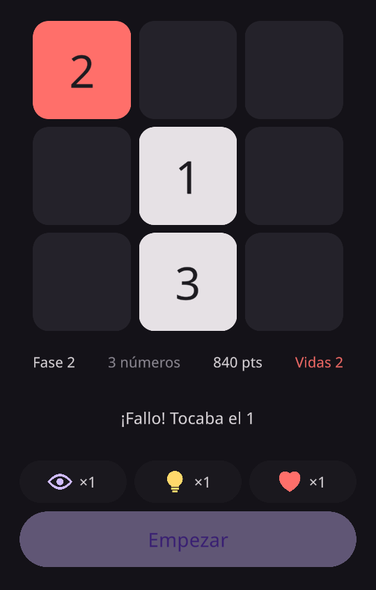

# Super Memory Numbers

Juego de memoria hecho en Unity 6 para el proyecto 1.1 «Probando Interfaces» de Aplicaciones Multimedia (2º DAM). Se enseñan unos números en un tablero de 3×3, se tapan y hay que pulsarlos en orden.

**Versión actual:** v0.1, placeholder jugable. El diseño completo está en el [GDD](GDD.md).



## Cómo se juega

1. Pulsa **Empezar** y memoriza dónde están los números.
2. Cuando se tapen, púlsalos en orden: 1, 2, 3…
3. Cada 2 rondas superadas se añade un número, hasta 9. Después empieza la fase 2, donde algunos números salen como `*` y hay que deducirlos.
4. Power-ups (1 de cada por fase): **ojo** para volver a verlos, **luz** para ver dónde está el siguiente y **corazón** para que un fallo no cuente.

## Abrir el proyecto

- Unity **6000.6.2f1**.
- Escena: `Assets/Scenes/SuperMemory.unity`.
- Menú **Super Memory** del editor:
  1. *Preparar*: importa TextMeshPro y genera los sprites.
  2. *Construir escena*: monta la interfaz desde cero.
  3. *Compilar para Linux (prueba)*: build en `Builds/Linux`.

Las reglas (números iniciales y máximos, aciertos para subir, tiempo visible, vidas y usos de power-ups) se cambian en el componente **SuperMemory** del objeto `Canvas`.

## Prueba automática

```bash
Builds/Linux/SuperMemoryNumbers.x86_64 -screen-fullscreen 0 -screen-width 540 -screen-height 960 -captura capturas
```

Juega una partida sola (acierta rondas hasta la fase 2, usa los power-ups y falla a propósito) y guarda capturas de cada momento en `capturas/`.

## Scripts

| Script | Qué hace |
|---|---|
| `SuperMemory.cs` | Lógica: rondas, fases, `*`, power-ups, vidas y puntos |
| `CasillaNumero.cs` | Cada casilla del tablero y sus aspectos (visible, tapada, acertada…) |
| `RejillaCuadrada.cs` | Mantiene el tablero cuadrado y entero en cualquier pantalla |
| `LayoutResponsive.cs` | Tablero arriba en vertical y a la izquierda en horizontal |
| `AreaSegura.cs` | Respeta el notch y la barra de gestos en móviles |
| `Pildora.cs` | Botones con los extremos redondos a cualquier tamaño |
| `CapturaAutomatica.cs` | Prueba automática con capturas |
| `Editor/ConstructorSuperMemory.cs` | Menú *Super Memory* que construye la escena y compila |
